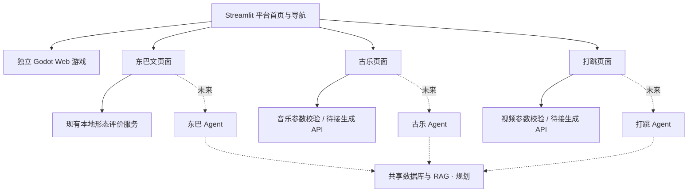

# Naxi AI Studio — 平台架构（Milestone 2）

## 定位与入口

纳西文化智能学习与创作平台，由一个独立 Godot 教学游戏和三个未来专业 Agent 组成。Streamlit 提供统一首页、顶部导航和返回首页链接；`app.py` 是唯一启动入口。

| 入口 | 页面 / 路径 | 当前能力 |
| --- | --- | --- |
| 纳西文化互动学习游戏 | pages/game.py / game | 连接已有 Godot Web 导出或配置的网址 |
| 东巴文临摹评价 Agent | pages/dongba.py / dongba | 原有鼠标画布、照片上传、本地图像评价及报告 |
| 纳西古乐 AI 创作 Agent | pages/music.py / music | 乐器、音色、情绪、风格、节奏、速度、时长、描述及参数下载 |
| 纳西打跳 AI 视频创作 Agent | pages/dance.py / dance | 参考视频预览、舞步、服装、场景、风格、时长、描述及参数下载 |

“Agent”表示产品规划。目前东巴是确定性评价原型，音乐与舞蹈是界面/参数原型，不能称为已有大模型 Agent。三个专业 Agent 独立运行，**不建立总控 Agent**。

## 技术与职责

- **Python**：文件校验、图像预处理与计算、参数验证、服务适配、配置和状态反馈；可预测操作不调用 LLM。
- **agents/dongba_agent.py**：未来独立编排形态比较、视觉辅助及有来源的学习反馈。
- **agents/music_agent.py**：未来独立检索文化/音乐资料、检查创作约束并调用生成服务。
- **agents/dance_agent.py**：未来独立核查动作/服装/场景资料并调用视频服务。
- 上述三个文件目前只有 Protocol 接口，不实例化、不调度工具、不调用 SDK。OpenAI Agents SDK 待模型/API 方案确定后引入。
- **services/dongba_evaluator.py**：已有真实可运行的本地形态评价，不是通用 OCR 或已训练模型。
- **services/music_service.py / dance_service.py**：类型化请求、普通 Python 参数校验、未来生成入口；当前生成调用明确抛出 NotImplementedError，不返回虚构媒体。
- 音乐/舞蹈页面的播放、生成作品预览和保存区域是待接入骨架。仅参数下载与参考视频预览是真实功能，不自动保存用户媒体。

## Godot 与 Streamlit 的连接

本次只读检查发现三个 Godot 项目。与当前网页导出对应的是：

- 工程：`D:\dachuang\naxi-game\project.godot`
- 主场景：`res://Scenes/MainMenu.tscn`
- 工程结构含 `Scenes`、`Features`、`Core`、`Data`、`Assets`、`Dialogues`、`Shared` 和 Dialogic 插件。
- Web 预设：`D:\dachuang\naxi-game\export_presets.cfg`，导出路径为 `../../livingnaxi-web2/index.html`。
- 现有导出：`D:\livingnaxi-web2`，包含 index.html、index.js、index.wasm、index.pck、启动图及音频 worklet。
- 实际 renderer 设置为 `gl_compatibility`；预设 `variant/thread_support=false`、`variant/extensions_support=false`。工程 features 标签仍含 Forward Plus，但实际 renderer 字段覆盖它。
- `D:\dachuang\naxi-ancient-music` 和 `D:\dachuang\新建游戏项目` 另有 project.godot，不作为当前游戏入口，也不修改。

Godot 4.6 文档支持 HTML5/WebAssembly 导出，要求 WebGL 2.0 和 Compatibility 渲染器；线程版本还要求隔离响应头。此工程的实际配置和现有导出具备 Web 接入条件。project.godot 只记录 4.6；本次浏览器运行导出文件实际输出 `Godot Engine v4.6.1.stable.official.14d19694e` 并完成引擎启动，确认该 Web 导出的运行时为 4.6.1。[官方 Web 导出文档](https://docs.godotengine.org/en/4.6/tutorials/export/exporting_for_web.html)

连接优先级：

1. `GODOT_WEB_URL` 非空：显示 HTTP(S) 游戏链接，不由后端下载或验证远端内容。
2. URL 未设置：使用 `GODOT_WEB_DIR`（默认 `D:/livingnaxi-web2`）。进入游戏页时，惰性启动缓存的只读 HTTP 服务，绑定 127.0.0.1 的自动空闲端口，直接读取原 Web 导出。
3. 未配置目录或文件不全：明确显示未接入提示，不假装运行。

游戏在新标签页独立运行，原平台标签保留导航。此方式不需要嵌入 iframe，避免游戏焦点、音频、存储及跨源隔离问题；未实现账号或游戏进度互通。首页入口先进入游戏说明页，再点击同名按钮打开游戏。

本机服务器只支持静态读取、限制目录边界与允许的资源后缀、不提供目录列表或上传接口，并设置 WASM MIME、COOP/COEP 响应头。服务随平台进程结束。它只用于这台电脑的演示；远程部署须使用可访问的 HTTPS 游戏地址和正式静态托管。

原 Godot 工程和导出文件均不修改、不复制、不移动，不重新导出。浏览器运行可能在该浏览器的站点存储中记录游戏状态，不写回原工程。

## 共享知识库与 RAG 规划

当前只有空的东巴教学 JSON 字库和已实现的 Schema/审核加载器。Godot 的存在不代表其资源已取得平台再利用授权，也不自动将游戏内容当作已核验知识。

未来使用 SQLite 保存字符、文化条目、作者/机构、出处/页码、版本、授权、审核状态与替代解释；原资料与结构化条目保持关联。三个 Agent 经同一个检索服务读取资料，各自决定如何使用；检索结果应返回可追溯来源。仅在数据规模和查询需求证明必要后增加向量检索。不安装数据库框架或 RAG 大型依赖来占位。

## 配置与安全

环境变量优先于 Streamlit secrets；不自动加载 .env，.env.example 仅记录变量名和说明。GODOT_WEB_URL 仅接受无用户名密码的 HTTP(S) 地址。模型密钥将只在对应后端适配器中读取，不进入页面、参数下载或日志。

保留 .gitignore；上传文件仅在会话内处理，不自动写入 Git 或训练集。没有自动提交、远程仓库、部署、模型训练或生成 API 调用。

## 后续路线

1. 完成游戏完整流程的人工试玩与托管选型；如需远程演示配置正式 Web 地址。
2. 核验并导入东巴目标字资料，收集合规标注样本，校准本地评价；设计视觉 API 和东巴专业 Agent。
3. 选择音乐 API，核验乐器/曲种资料，接入真实试听和下载。
4. 选择视频 API，整理有授权的动作、服饰、场景素材，接入真实生成任务、预览和下载。
5. 逐个接入 Agents SDK，增加必要的执行日志、结果验证和共享 RAG；不引入总控 Agent。

常规验收包含 Python 测试、语法检查、五页渲染和导航；浏览器脚本进一步检查东巴绘制/上传回归及可选 Godot 引擎启动。引擎成功启动不等于完整通关、文化内容审核或所有浏览器兼容性测试通过。
