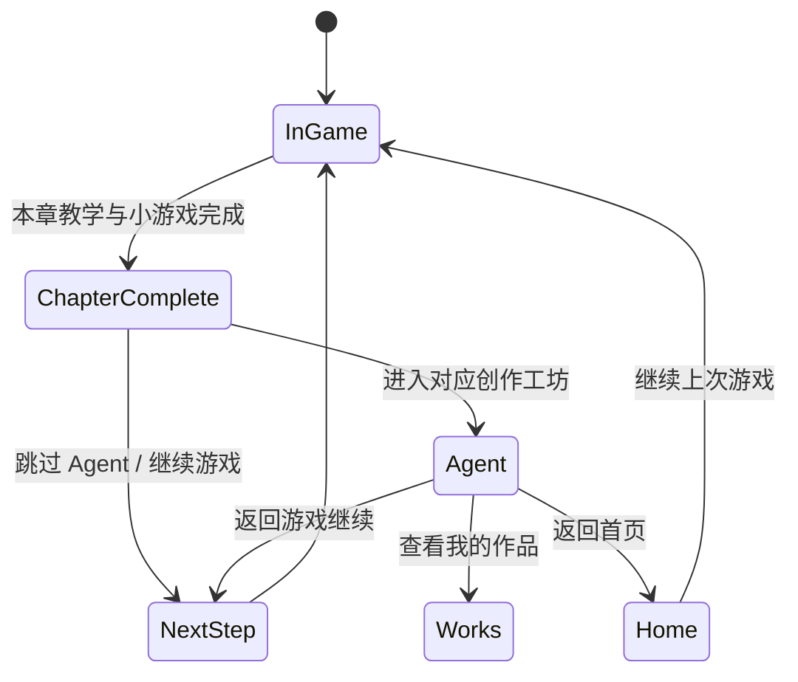

# Milestone 6：游戏与专业 Agent 串联及任务调度设计

状态：设计稿；本轮未调用 Qwen/Wan，未改现有 Agent。**统一调度**指跨模块的权限、进度、任务、费用和作品管理，**不是**让一个“总控 Agent”代替三个专业模块。现有实现依据来自实际代码，旧报告中的“舞蹈仅接口占位”已过时：当前 `services/dance_service.py` 和 `pages/dance.py` 已有 Wan 2.7 异步 HTTP 与页面提交流程，但还没有真实生成验收。

## 1. 现有三个模块的真实能力与边界

| 模块 | 已由当前代码实现 | 尚未验证/缺口 | Web 复用方式 |
| --- | --- | --- | --- |
| 东巴文 | `pages/dongba.py` 目标字选择、画布/照片；`naxi_agents/dongba_agent.py` 标准图查找、质量检查、一次双图 Qwen 视觉或 OpenAI Responses 请求、六字段校验、显式 Mock 回退；`services/learning_records.py` 本地学习元数据 | 通用视觉模型非东巴文专用模型；五字来源/专家审核未完成；单机学习库非多用户系统 | 保留 `DongbaHandwritingAgent.evaluate` 业务边界，FastAPI 薄包装；返回 `source`、模型估计与本地测量标签 |
| 音乐 | `pages/music.py` 曲谱上传/预览/校对；`score_omr.py` 简谱 Qwen 视觉与五线谱路径，`naxi_agents/music_agent.py` 一次可选文本规划或本地规则，`music_render.py` MIDI/WAV 本地输出与采样来源说明 | 识谱有人工校对门槛；音色样本有限；改编不能称正宗纳西古乐；没有跨用户作品库 | 保留识谱→人工校对→规划→确定性合成；曲谱和录音不上传给未配置的平台 |
| 打跳视频 | `pages/dance.py` 本人 MP4/照片与现有服饰背景素材预览、用户同意、显式提交与手动刷新；`services/dance_service.py` 临时私有上传、Wan 2.7 异步创建/查询/下载与结果检查 | `agents/dance_agent.py` 仍只是 Protocol；真实 Wan 生成未在本轮验证；页面作业只在 Session State，音乐合成尚无 | 封装既有 async service，不把它描述成已完成自治 Agent；任务 ID 持久化后再接 Web 页面 |

`services/qwen_service.py` 统一读取服务端配置，文本走 `QWEN_TEXT_MODEL`、图片走 `QWEN_VISION_MODEL`；代码阻止图片送文本智能路由。API 模型实际可用性以已有独立测试记录为准，本轮没有复测或产生 Token。`score_omr.py` 对不确定音符要求人工校对，不能自动补写音乐。音乐 Agent 的“AI”是**编排计划**，实际 MIDI/WAV 是 Python 的确定性生成；本地规则回退需明确标记。舞蹈 `DanceRequest` 的旧舞步选项只是意向，Wan 2.7 实际编辑的是**玩家上传视频**。

## 2. 游戏完成点与 Agent 往返契约

| 完成步骤 | 可进入的 Agent | 继续点 | 传递的上下文 |
| --- | --- | --- | --- |
| `dongba_complete` | `/studio/dongba` | `clear_story` | `run_id`、完成步骤 ID、`return_step_id=clear_story`；若教学当前字与五字图库无可靠 ID 映射，不自动替玩家选字 |
| `music_complete` | `/studio/music` | `dance_intro` | 同上；不把教学音乐片段自动当成有授权曲谱 |
| `dance_complete` | `/studio/dance` | `dance_transition` | 同上；教学 OGV 不作为 Wan 编辑输入，玩家自行上传本人 MP4 |

进入 Agent 前先事务性保存完成状态和下一步 ID；“跳过”只表示跳过 Agent 延伸体验，不能把原教学关卡标为 skipped。Agent 失败或取消不回滚已经完成的教学内容。若从首页独立进入 Agent，`return_step_id` 为空。用户从 Agent 返回游戏时读取最新存档并确认属于同一 `run_id`；不盲信浏览器 URL 中的 step ID。游戏进行中随时退出写入子状态（对话行号、书页、题目队列/错题计数、舞蹈阶段/口诀排列）；菜单中的“重新开始”需要明确重置本次 run 的含义。作品列表列出生成中的任务及已完成作品，Mock/失败不冒充生成作品。

## 3. 调度服务最小契约

| 操作 | 输入 | 输出/副作用 | 重复提交策略 |
| --- | --- | --- | --- |
| `POST /api/v1/jobs/dongba` | `character_id`、书写图、输入方式、同意标志 | 校验图像，记录结果 `source`、状态、模型信息和可解释反馈 | 同一提交 nonce 幂等；没有通过本地质量检查不调用 Qwen |
| `POST /api/v1/jobs/music/recognize` | 真实曲谱图/文件 | 识谱草稿及逐音不确定标记 | 校对前不能进入 MIDI 生成；按素材摘要复用草稿而非重复计费 |
| `POST /api/v1/jobs/music/arrange` | 已确认音符、乐器资产 ID、风格参数 | 规划来源、MIDI/WAV、采样来源清单 | 同一确认版本只生成一次；本地规则与 Qwen 规划来源区分 |
| `POST /api/v1/jobs/dance` | 玩家 MP4/身份照、服饰/背景 ID、明确同意、幂等键 | 任务 ID、状态；服务端提交 Wan | 先持久化 `reserved`；网络不明时不自动重提，避免重复计费 |
| `GET /api/v1/jobs/:id` | 任务 ID | 状态、错误类型、实际用量、作品 ID | 只查询，不创建新任务 |
| `GET /api/v1/works` | 用户 ID | 仅该用户可见的完成作品 | 与任务记录关联，下载使用短期授权 |

服务端适配层仅调用已有服务函数，统一处理输入大小/类型、用户授权、错误分类、任务状态、Token 或视频任务费用、日志脱敏、作品保存。舞蹈异步状态需要跨进程持久化；不能沿用 Streamlit Session State 作为正式任务库。只有外部接口返回 `SUCCEEDED` 且下载/容器验证成功才登记 MP4 作品。未确认请求是否创建成功时设 `unknown` 并人工/控制台核对，不再扣款调用一次。管理员暂停视频生成和日预算在真正创建外部任务之前检查。

## 4. 舞蹈音乐与后期合成

当前新素材 `data/dance/dance_music/纳西三部曲.mp3` 可解码为约 9.199 秒、48 kHz 双声道 MP3；未找到拍号/BPM/起拍或教学动作时间配置。音乐上传与节拍检测应输出“候选+置信度”，波形中由人确认起拍/拍号/两小节边界，保存版本化 `beat_map`：`source_file_hash`、`bpm_confirmed`、`meter_confirmed`、`first_beat_seconds`、`bar_boundaries_seconds`、`step_id/action_id` 对应拍点、校对人/时间。原 `content.json` 的 `actions[*].start/end=null` 不能被当成已有时间映射。

Wan 只处理本人视频和人物/服饰/背景图。生成成功的 MP4 在本地服务端用 FFmpeg 与已授权音乐副本合成：按确认边界裁两小节，必要时循环或按用户选择保留原时长，选择原声混音/替换，添加淡入淡出，检查音画同步后出新 MP4。不要调用额外音乐生成 API，也不要修改原 MP3 或原 MP4。当前本机未在 PATH 中发现 FFmpeg/ffprobe，所以这条链路要在后续批次安装或配置后实测，不能标为已实现。

## 5. 成本、隐私与人工验收

- 前端在按钮前显示预计使用的服务/媒体发送范围；视频默认需要用户明确同意。不要让页面重绘、轮询或返回游戏触发生成调用。
- 记录模型 ID、HTTP/任务状态、输入输出 Token 或服务商计费项、估算和实付、Mock/本地规则标志；不记录密钥、完整 Base64、私人原图或模型原始敏感响应。
- 私人上传使用短期私有对象；作品到期清理和用户主动删除需要明确策略。未确认保存期限前只保留任务元数据与受控临时对象。
- Agent 结果不能替代文化审核：东巴图释义、音乐风格标签、服饰名称与场景出处保留数据源和待核验状态；不凭模型补文化事实。
- 首次真实 Wan 实验、音乐节拍确认与身份一致性评价都留待用户选定设计并授权下一阶段后执行；本轮没有 API 调用。
