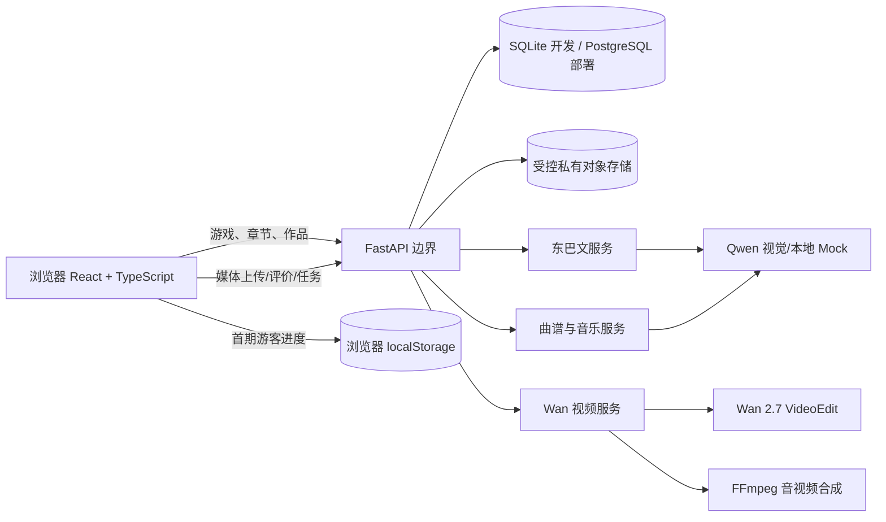

# Milestone 6：原生 Web 平台技术架构（设计稿，未实施）

本轮仅设计，不改变现有 Streamlit/Godot/Agent 运行版本。依据：`docs/MILESTONE_6_GODOT_AUDIT.md`、当前 `app.py`、`pages/`、`services/`、`naxi_agents/` 和 `data/dance/dance_music/`。目标是**游戏为首页和学习主线，Agent 为可跳过的学习延伸**；三个专业能力保留各自业务边界，统一的是身份、任务、存档、成本和导航，**不新建总控大模型 Agent**。

## 1. 分层与部署

- 前端：React、TypeScript、HTML5 Video/Audio、DOM/CSS；仅需要确实是逐帧绘制的效果才使用 Canvas。原 Godot 图片/字体、对话数据和 `Data/content.json` 转为有来源映射的只读 Web 静态资源。**不能把 Godot HTML5 导出放入 iframe 代替迁移**。
- 后端：渐进增加 FastAPI 薄适配层，直接复用 `services/qwen_service.py`、`services/score_omr.py`、`services/dance_service.py`、`naxi_agents/` 与现有纯 Python 函数；不在本轮改变它们的签名。现有 Streamlit `app.py` 继续可运行，直至逐关验收后切换入口。
- 数据层：本地演示 SQLite；部署选择 PostgreSQL。用户进度、题目逐项状态、Agent 任务、作品元数据和成本记录有持久存储。大型媒体在私有对象存储，数据库只存受控对象 ID、校验值、保留期限。游客本地存档能在同一浏览器恢复，但不能声称跨设备同步。
- 密钥：只存在服务端环境变量/Secrets；前端不读取 `DASHSCOPE_API_KEY`、`OPENAI_API_KEY`，不代理任意 URL。视频媒体发送百炼前必须显示明确同意。异步任务/费用在服务端完成幂等和预算判断。

## 2. 统一页面与信息架构

| 路由 | 主任务 | 当前来源 |
| --- | --- | --- |
| `/` | 首屏游戏大幅主视觉：开始、继续、章节目录；下滚才是三个 Agent | `MainMenu.tscn`、原场景图 |
| `/chapters` | 章节、关卡状态；从指定关卡开始、跳过、重玩 | `GameManager._flow` + 新存档设计 |
| `/game/:stepId` | 15 步原生游戏，叙事/书/问答/舞蹈/完成/结局 | 11 个场景、Dialogic、`content.json` |
| `/studio/dongba` | 目标字双图临摹评价 | 现有 `pages/dongba.py` 和服务迁移适配 |
| `/studio/music` | 曲谱识别、校对、改编与试听下载 | 现有 `pages/music.py` 和音乐服务适配 |
| `/studio/dance` | 玩家本人视频/照片+服饰/背景/音乐，异步视频编辑 | 现有 `pages/dance.py`/`dance_service.py` 适配 |
| `/works` | 已生成作品和处理状态、受控下载/删除 | 新作品索引；不把旧临时结果伪装成持久作品 |
| `/account` | 将来登录与跨设备同步 | 后续实施，游客阶段无需强制账号 |

游戏完成页给出“进入本章 Agent / 跳过并继续”两个明确动作。Agent 内提供“返回游戏下一关 / 首页 / 我的作品”；可独立访问时没有游戏返回点，就只显示首页/作品。导航恢复通过服务端 `return_step_id`/进度记录或游客本地存档，不能仅靠 React 内存或 Streamlit Session State。

## 3. 原数据到 Web 的映射

1. 把 `GameManager._build_flow` 的 15 个稳定 ID 固化为版本化 `gameFlow` 清单，顺序与旧项目一致；页面状态保留 `step_id` 而非数组下标。改变流程时提供版本迁移表。
2. 解析 `Dialogues/*.dtl` 中本项目用到的 `background/join/leave/clear/wait/audio` 与对白，保留**原文本与顺序**，不调用模型补写。`host.dch`/`tourist.dch` 肖像及位置映射到 `DialogueStage`。
3. `Data/content.json` 的 quiz/book/completion/dance 原样作为内容源；只转换资源 URL 格式。脚本中引用的缺失文件以“资源缺失”状态显示；不要用占位文化内容填补。
4. 对 `Assets/` 88 项和 `icon.svg` 建立源路径、Web 路径、SHA-256、媒体类型、授权状态映射。只复制/转码**经核对的构建副本**；原工程只读。字体许可文本随字体保留。9 段 OGV 需要浏览器可播编码副本与音轨检查。
5. 样式保留现有背景和肖像，先由本轮 Oil UI 三方向决定首页视觉，再统一游戏和 Agent 的导航外壳；业务表单可以在迁移阶段逐项接入，不提前覆盖 Streamlit。

## 4. 存档与账号数据契约

建议最小表：

| 实体 | 关键字段 | 约束 |
| --- | --- | --- |
| `users` | `user_id`, `mode` (`guest`/`account`), `created_at` | 游客本地可暂用随机 ID；正式账户独立认证 |
| `game_runs` | `run_id`, `user_id`, `flow_version`, `current_step_id`, `chapter_id`, `last_played_at`, `revision` | 自动保存，乐观并发版本避免覆盖较新进度 |
| `step_progress` | `run_id`, `step_id`, `status` (`not_started`/`in_progress`/`completed`/`skipped`), `detail_json`, `updated_at` | 对话行、书页、问答轮次/错题次数、打跳子阶段须可恢复；重玩产生新 attempt，历史不抹除 |
| `agent_jobs` | `job_id`, `user_id`, `agent_kind`, `source`, `status`, `idempotency_key`, `model`, `provider_task_id`, `cost_estimate`, `actual_usage_json`, `created_at` | 输入摘要和作业 ID；不会把 Mock 当真实 AI；一次按钮一次任务 |
| `works` | `work_id`, `job_id`, `user_id`, `kind`, `object_id`, `metadata_json`, `created_at`, `expires_at` | 私有作品索引，上传原件默认不入作品库 |

游客 `localStorage` 存 schema/version、游戏状态与非敏感作品索引；不得存 API Key、私人照片或视频本体。正式部署的登录用户由服务端持久化并以用户 ID 隔离。已有 `services/learning_records.py` 使用本机用户目录 SQLite 存东巴学习元数据，是**单机记录**，不是多人账户库；迁移时通过明确数据迁移/导入，不直接当线上库。退出游戏时自动写入当前子状态；失败时阻止误报“已保存”。章节目录允许任意关卡进入需明确“练习跳关”语义，不把跳过标成完成。

## 5. 统一任务与成本护栏

统一的任务服务负责鉴权、参数校验、用户同意、幂等键、估算成本、额度检查、创建任务、状态查询、结果验证与作品登记；**不决定三个 Agent 的业务推理**。幂等键由 `user_id + agent_kind + 标准化输入摘要 + 明确提交 nonce` 生成；首次请求先持久写 `reserved` 再调用外部 API，网络结果不明时查询原任务/人工核对，绝不自动二次提交。对 Qwen 记录模型、输入/输出 token、请求来源和失败类型；对 Wan 记录任务 ID、参数与服务商实际计费信息（未返回时为 `unknown`），费用估算和实付分开。管理员暂停视频生成、用户每日次数/预算阈值、总预算熔断均在服务端；本轮不实现支付/积分扣款。

## 6. 音乐与视频合成方案（基于真实现状）

`data/dance/dance_music/` 目前只有 `纳西三部曲.mp3`：230,147 字节，`soundfile` 可读为 MP3、48 kHz、双声道、约 **9.199 秒**。目录下**没有**两小节节拍配置文件或逐动作时间标注；`content.json` 里 3 段教学动作的 `start/end` 均为 `null`。这段音频的名称来自用户文件名，拍号、BPM、起拍及文化来源尚未证实，不能自动写死为“纳西三部曲标准节拍”。本机 `.venv` 可读 MP3，但 `ffmpeg`/`ffprobe` 未在 PATH 中发现。

正式实现链路：上传或选择有使用权的原始音乐→保留来源与原件→解码并计算起拍/BPM **候选**及拍号 **待校对** → 在波形/拍点界面人工确认起拍、拍号、两小节边界 → 将确认的 beat 时间轴与教学步骤的动作 ID 建映射（原口诀顺序不改）→ Wan 只接收玩家本人视频、身份照、服饰和背景，不发送教学 OGV 或音乐给视频生成模型 → 生成 MP4 成功后用 FFmpeg 对结果副本裁切/循环/淡入淡出选定音乐段并合成，保留原视频长度/音轨策略与署名元数据 → 检查 H.264/AAC、时长、同步、可播、大小后交付。若检测不能确定拍号或音乐不足两小节，停在人工校对，不伪造节拍。原视频背景音与新音乐的混音/替换由用户选择；避免双重音轨。未安装 FFmpeg 之前该链路仅是设计。

## 7. Oil UI 三方向对比与选择

独立对比页：[`docs/milestone6_design/style-explorer.html`](docs/milestone6_design/style-explorer.html)。A/B/C 各有响应式桌面/手机 HTML，使用原 Godot 的古城、雪山、牧场画面和 Ma Shan Zheng 字体的**预览副本**；原文件未改。截图见同目录 `sheet.png` 和 `a|b|c-1440x900.png`、`a|b|c-390x844.png`。这些是首页视觉原型，不代表游戏或 Agent 已迁入其中。

| 方向 | 首屏构图 | 视觉重点 | 代价/风险 |
| --- | --- | --- | --- |
| A 雪山古城沉浸式 | 古城原图全屏、左侧标题与三条游戏动作 | 游戏入口最直接、延续原场景叙事 | 图片上叠字的对比度和手机裁切需持续检查 |
| B 东巴文化典藏式 | 纸面阅读区与雪山图像双栏；手机图上文下 | 呼应原文化书纹理，适合长篇知识页 | 首页动势较弱，手机首屏阅读距离更长 |
| C 民族未来科技式 | 左侧章节轨道、右侧场景窗口与深靛蓝 | 平台与数字创作连接更强 | 科技语法更突出，需防止盖过游戏的文化美术 |

**推荐先选 A**：原游戏古城画面成为最强辨识点，首屏的“进入/继续/章节”清晰，向下才出现 Agent；它最贴近本轮“游戏是核心入口”的约束。若用户更重视阅读与文化书的统一感，B 值得进一步深化。正式实施前由用户选择方向或指出要拼合的部分，本轮不覆盖生产首页。

## 8. 现有版本保护与实施门槛

本轮**没有**创建 React/FastAPI 工程、改 `app.py`、改 `.env`、调用 API 或改 Godot。后续每一批迁移必须：固定旧版基线、转码副本与资源映射核验、逐场景对照截图和行为测试、相同数据题目结果对比、游戏进度刷新恢复测试、Agent 原服务回归；完成一关再接下一关。原 Streamlit/Godot Web 导出继续作为可运行回退版，直到全部 15 步和三个 Agent 路径验收。
