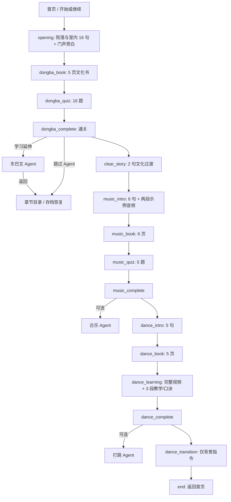

# Milestone 6B：Dialogic 剧情与 Web 状态映射

来源：只读核对 `D:\dachuang\naxi-game\Core\GameManager.gd`、`Dialogues/*.dtl`、`Dialogues/*.dch`、`Data/content.json` 和 `Scenes/VNStage.gd`（2026-11-09）。**“83 个 Dialogic 场景”实际是 `addons/dialogic/` 下的 83 个插件 `.tscn`，属于编辑器/运行插件资源，并非 83 条原创剧情。** 项目原创剧情只有 6 条 `.dtl`，项目自有场景 11 个 `.tscn`；全工程 `.tscn` 共 94 个。迁移需要保留 6 条原创时间线的行为，不把插件内部界面误当剧情关卡。

## 真实主线与页面状态

`dongba_intro.dtl` 虽存在但**不在** `GameManager._build_flow()` 中，不应悄悄插入主线。`dance_transition.dtl` 只有背景切换，没有人物对白或选择。六条 `.dtl` 中没有 Dialogic 选项、跳转、标签或 signal 指令；当前主线推进由 `VNStage` 时间线结束后的 `GameManager.advance()` 驱动。Agent 分支是 Web 新增的学习延伸选择，**不是原 Dialogic 剧情选项**。

| 时间线 | 原指令与人物/背景 | 故事与触发条件 | Web 页面/状态 | 6B 状态 |
| --- | --- | --- | --- | --- |
| `opening` | `bg_at_home_yard.png` → 黑屏门声 → `bg_in_the_room.png`；`tourist` 左、`host` 右；16 句对白 + 1 条门声旁白；`join/leave/clear/wait` | 朋友迎接游客，介绍木门上的东巴文；进屋看牌匾并发出挑战。时间线结束进入文化书 | `/game/opening`；`dialogueIndex` 按 17 个可见节点保存，逐句推进后进入 `dongba_book` | 已迁移；原文在 `web/src/game/dialogues.json` |
| `dongba_intro` | 室内背景；两人物；5 句对白 | 另一段东巴介绍；当前主线不调用 | 仅留源数据，未来若原游戏启用需另定入口 | 未接入主线，符合原工程 |
| `clear_story` | 室内背景；两人物；2 句对白 | 东巴通关后过渡到后续文化内容 | `/game/clear_story`，完成后 `music_intro` | 待迁移 |
| `music_intro` | 室内背景；两人物；6 句对白，`audio example` 播放/停止两次，`wait` 两次 | 听两段问答反馈音乐并谈古乐，结束进音乐文化书 | `/game/music_intro`；需保留音频开始/停止/等待事件 | 待迁移；原文本中的曲种称谓与音频文件名疑似相反，需文化与素材人工核对 |
| `dance_intro` | 室内背景；两人物；5 句对白 | 朋友引出打跳教学，游客表达体验意愿；结束进舞蹈文化书 | `/game/dance_intro` | 待迁移；文化表述未核来源 |
| `dance_transition` | 仅 `bg_in_the_room.png` | 原时间线无对白，结束即进结束页 | `/game/dance_transition`，自动推进到 `end` | 待迁移 |

人物源文件 `host.dch` 和 `tourist.dch` 定义站位、颜色及肖像状态。6B 东巴样板复用 `char_male_casual.png`、`char_tourist_camera.png`；完整立绘状态和原 Dialogic 动画参数待逐项迁移。`opening` 的门声是**文本旁白**，原项目没有独立门音文件，Web 不虚构音效。文化与历史陈述只按原剧本呈现，尚未由文化专家复核。

## 非剧情关卡转换与存档

原 `GameManager` 的 15 步顺序完整列于图中。`quiz` 错答跨轮累计，第三次答错标记 `skipped` 并移出队列；答对标记 `done`。原 `pass_ratio` 未用于通关判定，原存档只记录 `step_id`，重入问答会重置。本 Web 样板保留 16 题内容和错答规则，同时把题目队列、累计错答、已答/跳过状态及待确认反馈写入游客本地存档。完成、跳过与 Agent 使用记录分离；不能将 `skipped` 视为 `completed` 的同义词。当前阶段浏览器本地存储适用于单机游客，不承担跨设备云同步。

对话顺序和资源事件的机器可读版本在 `web/src/game/dialogues.json`；原 `Data/content.json` 的东巴文化书、题库、通关数据只读导入到 `web/src/game/dongba_content.json`。未迁移的主线节点在目录中显式标记，不可游玩。
